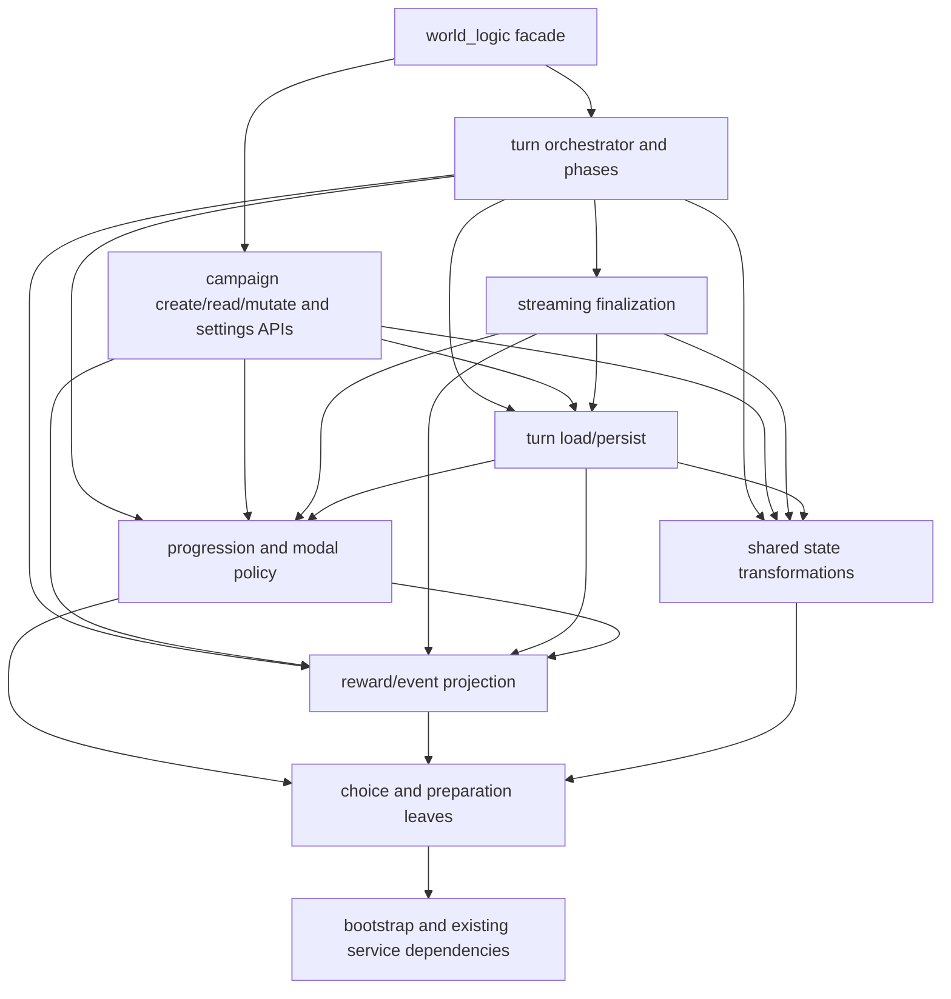

# world_logic.py modularization plan

**Status:** Revised design; implementation belongs in [worldarchitect.ai](https://github.com/jleechanorg/worldarchitect.ai).
**Prior draft:** [worldarchitect.ai PR #10433](https://github.com/jleechanorg/worldarchitect.ai/pull/10433). This document replaces its fixed module-count proposal with staged, dependency-led decomposition.
**Pinned baseline:** `1dd545dd6b3922bfc219abe9ae01732690d2c221` (2026-10-12), **12,966 physical lines**, **171 top-level definitions**, **12,219 summed AST definition-span lines**. These are different measurements.
**Related work:** [design-retro Finding 01][retro], beads `rev-0yt8m` and `rev-n25ez`, [design-doc Gate 6][gates] (14,000 at the pinned baseline).

## 1. Decision and authorization boundary

Keep `mvp_site/world_logic.py` as the public facade and extract cohesive sibling modules under `mvp_site/`. The existing `create_quick_start_campaign_unified` re-export demonstrates API compatibility, **not dependency monkeypatch compatibility**. Preserve public names, signatures, sync/async behavior, return/error contracts, and startup behavior throughout.

The original direction is sound, but ten siblings is not an acceptance criterion. The cited design-retro requires **every new module ≤1,000 physical LOC** and **each extracted phase <300 lines**. Group names below describe responsibility families, potentially spanning several files. A 2,950-line progression file or 3,400-line turn file is not an acceptable intermediate landing. The older ≤4,000 facade bead target is an intermediate milestone; this plan's P10 facade target is **≤800**.

**This PR authorizes documentation fixes only.** It does not authorize production implementation, merge/deploy, service or credential changes, paid provider use, automated account writes, or public evidence publication. Runtime evidence is N/A for this docs-only change; no provider calls are needed. Future implementation PRs need an executing owner, risk-scoped validation/evidence owner, and named revert owner before work starts. Record the base/head SHA, symbol manifest, tests, evidence scope, authorization limits, and rollback unit in each PR. Missing real-service access or spending authorization blocks that implementation gate; it never waives it.

No schema or stored-data migration is part of this refactor. Keep Firestore document shape, field ownership, prompts, provider selection, cache-prefix bytes, game rules, and observable behavior unchanged. A needed semantic fix is a separate work item with its own reproducer and authorization.

## 2. Baseline inventory and measurement

All line references in this document refer to the pinned [source][source], not a moving `origin/main`. Recompute the inventory and dependency graph on the actual implementation base before each extraction. Line bands locate code; **they do not assign ownership**.

| Source region | Inclusive lines | Physical lines | Summed AST spans of definitions starting in band |
|---|---:|---:|---:|
| Bootstrap | 1–220 | 220 | 10 |
| Rewards / story projection | 221–2270 | 2,050 | 1,846 |
| Progression / modal | 2271–5235 | 2,965 | 2,843 |
| Streaming / preparation | 5236–6094 | 859 | 845 |
| Persistence / living world | 6095–7383 | 1,289 | 1,218 |
| Create / god-mode / choice helpers | 7384–8926 | 1,543 | 1,503 |
| Turn entrypoint | 8927–11222 | 2,296 | 2,294 |
| Page-load helpers | 11223–11580 | 358 | 344 |
| Read API | 11581–11803 | 223 | 221 |
| Mutate / export / list APIs | 11804–12115 | 312 | 300 |
| User settings | 12116–12393 | 278 | 236 |
| Terminal sync / combat / SET | 12394–12966 | 573 | 559 |
| **Total** | | **12,966** | **12,219** |

AST span means `end_lineno - lineno + 1`, including internal comments and blanks, excluding surrounding imports/interstitial text. The table assigns a definition by its starting line, so a span can cross a band boundary. Earlier 1,846 / 2,948 / 3,336 figures were assignment estimates, not measured physical destination-file sizes. Imports, docstrings, wrappers, relocated helpers, and phase boundaries change destination sizes; measure actual files rather than adding estimates and calling them verified.

From a clean code-repo checkout, reproduce the baseline without running services:

```bash
git show 1dd545dd6b3922bfc219abe9ae01732690d2c221:mvp_site/world_logic.py | wc -l
python3 - <<'PY'
import ast
import subprocess
source = subprocess.check_output([
    "git", "show",
    "1dd545dd6b3922bfc219abe9ae01732690d2c221:mvp_site/world_logic.py",
], text=True)
definitions = [n for n in ast.parse(source).body
               if isinstance(n, (ast.FunctionDef, ast.AsyncFunctionDef, ast.ClassDef))]
print("definitions:", len(definitions))
print("AST span lines:", sum(n.end_lineno - n.lineno + 1 for n in definitions))
for n in definitions:
    if n.name == "process_action_unified":
        print(n.name, n.lineno, n.end_lineno, n.end_lineno - n.lineno + 1)
PY
```

Expected: `12966`, `171`, `12219`, and `process_action_unified 8927 11220 2294`.

### Stable callers

`mcp_api.py`, `mcp_client.py`, `main.py`, and `worldai_mcp_stdio.py` consume the facade. Inventory their actual public and private uses, including `main.py`'s `_strip_*` helpers, plus direct imports and patch targets in tests. Do not limit the compatibility inventory to a sample of heavily patched names.

The pinned [MCP client's mapping][client] has **nine tools**: `create_campaign`, `quick_start_campaign`, `get_campaign_state`, `process_action`, `update_campaign`, `export_campaign`, `get_campaigns_list`, `get_user_settings`, and `update_user_settings`. They resolve to the corresponding facade `*_unified` functions; quick start resolves to `create_quick_start_campaign_unified`.

## 3. Ownership and acyclic extraction

Before moving a function, inventory its global reads, direct and indirect calls, module aliases, constants, lazy services, and import-time side effects. Assign shared leaves by dependencies, not by location or a level-up/god-mode name. Review dynamic calls manually; an AST direct-call graph alone is incomplete.

Concrete traps at the pinned baseline:

- `_enforce_level_up_non_finish_commit_invariant` (2392) calls `_normalized_modal_choice_id` (8759), which calls `_extract_modal_choice_key` (4152). A band-based progression → turn/create → progression split cycles. Put both choice helpers in a shared modal-choice leaf before either consumer moves; keep compatibility aliases at the facade.
- `_reconcile_level_up_ui_pair` calls `normalize_rewards_box_for_ui`. Put reward normalization below progression; any reward-band helper requiring progression belongs above that leaf, not in a mutually importing rewards module.
- `finalize_streaming_state_before_persistence` (5343) calls terminal/combat helpers near the end of the file (`apply_automatic_combat_cleanup`, `apply_social_hp_challenge_terminal_sync`) and preparation/progression helpers such as `_seed_starting_spells_if_missing` and `ensure_level_up_rewards_pending`. Extract their dependency closure first. Streaming also participates in the persistence path: preserve preparation, finalization, and write ordering, and inventory external streaming callers. Do not defer its state-mutation dependencies to P8.
- `_maybe_trigger_level_up_modal` remains a persistence concern consuming progression/choice leaves. God/spicy/faction helpers scattered through the create and streaming bands need dependency-based ownership. Shared spicy helpers cannot move into the turn orchestrator while streaming still calls them.

### Dependency layers (consumer → dependency)

The diagram is a permitted family graph, not a claim that the current source already has these boundaries. Internal files within each family also need a DAG. Lower layers may import established external services/helpers only if the complete graph remains acyclic.



Edges are permissions, not required imports. Higher layers may also use lower leaves/bootstrap directly. Persistence must not import streaming, and shared mutation/preparation code must not import campaign API modules. If analysis finds a required reverse edge, extract its shared leaf or defer that consumer; do not conceal the cycle with function-local imports. Existing lazy service loading remains lazy, with one initialization owner.

**Every intermediate PR must be acyclic.** The facade may temporarily retain unmoved consumers importing extracted leaves. No extracted sibling may import the facade, even temporarily, including via a lazy backwards import. Before each PR, commit/review a symbol-to-owner manifest and topological order for the moved closure; after it, check imports across the complete production graph (including existing `quick_start_campaign`, services, and callers). Run fresh-process imports in facade-first, sibling-first, and relevant service-first orders so `sys.modules` caching cannot hide a cycle. Also check AST/static import edges, including local imports, against the permitted directions; smoke imports alone do not prove absence of cycles.

## 4. Facade and patch contracts

A re-exported function executes with its defining module's globals. After moving `f` into a sibling, patching `world_logic.dependency` does **not** intercept `f`'s lookup of `sibling.dependency`. A thin facade wrapper calling `sibling.f` does not repair that lookup either.

For each extraction, classify patch sites as (a) callers replacing the facade entrypoint, which can stay, or (b) dependencies looked up inside moved functions, which must move to the actual lookup module. Migrate every affected dependency target **atomically with that extraction**, without an arbitrary update-count cap or P10 deferral. Search decorators, string patches, `patch.object`, monkeypatch fixtures, direct imports, and shared fixtures. Preserve test intent and assertions; if a fixture contract must change, explain and review it explicitly.

Required contract checks start with the first extraction:

- Compare baseline and new export inventories for all inventoried consumers and all nine MCP mappings; preserve parameter names/order/defaults, keyword-only parameters, annotations where contractual, and coroutine/generator behavior.
- Call through the facade and assert that a sentinel dependency patched at the new lookup site was invoked with expected arguments (and awaited where applicable). Existence or `dir()` checks alone are insufficient.
- Exercise observable results, exceptions, and side effects through MCP/HTTP consumers at the appropriate layer. Preserve private aliases that real callers still use; remove an alias only after all consumers are migrated and tested.
- Preserve lazy loading and initialization count/order. Do not introduce eager service imports, duplicate bootstrap instances, Mock detection, or test-mode production branches to make patches pass.

## 5. Staged implementation sequence

P0 is this docs-only plan. P1–P10 are implementation milestones, **not a promise of ten PRs or ten files**. Split a milestone into independently reviewed, dependency-ordered PRs where needed. Each PR names its owner, evidence owner, revert owner, and actual moved symbols. The symbol manifest, physical size budget, and gate changes are part of that PR's acceptance, not deferred cleanup.

| Stage | Scope and prerequisites | Required proof |
|---|---|---|
| **P1** | Baseline consumer/patch/side-effect inventory; characterization tests; graph and size checks; extract bootstrap only if its dependency closure is a leaf | Facade contracts, initialization/lazy-load parity, fresh-process imports |
| **P2** | Extract shared choice, preparation, terminal/combat state transformations, then reward/event leaves in topological order; keep progression-dependent projections with unmoved consumers until P4 | Actual lookup-site patch interception, state equality, migrated design gates with negative fixtures |
| **P3** | Extract page-load/read code only when all dependencies are already extracted; otherwise retain the consumer until P4/P5 | Pagination, aliases, reconciliation, response parity; no backwards facade imports |
| **P4** | Decompose progression into cohesive ≤1,000-line modules (e.g. modal lock, finish choices, invariants, story projection); shared choice leaves already in P2 | Modal/freeze-time/creation-lock characterization; preserve reward-normalization direction |
| **P5** | Extract remaining turn load/persist dependencies first, then streaming finalization; split the roughly 2,000-line combined responsibility across compliant files | State/write ordering, exception paths, streaming completion/payload aliases, risk-scoped real-path evidence |
| **P6** | Extract true campaign creation and its dependency closure; do not sweep the whole create band into it | Creation/quick-start API and prompt-byte parity; preserve lazy setup |
| **P7a** | **Separate structural refactor:** decompose `process_action_unified` in place into reviewed phases <300 lines; extract phases leaf-first into ≤1,000-line siblings until orchestrator ≤400 | Baseline order/state/exception/early-return/persistence characterization plus meaningful mutation checks (§6) |
| **P7b** | **Relocation only:** move the now-small orchestrator and remaining god/faction helpers to appropriate compliant siblings; shared spicy helpers stay below streaming and turn | Body equivalence modulo imports, complete patch migration, facade/API parity, streaming real-path evidence |
| **P8** | Extract remaining campaign update/export/list/SET API consumers; their shared state-transformation dependencies landed before P5 | API/auth/error/state parity; no duplication of shared mutations |
| **P9** | Extract user settings consumers | HTTP/MCP signatures, errors, security boundaries, user-document behavior |
| **P10** | Remove proven-unused private shims; retain the public facade; finish size/complexity ratchets | Facade ≤800, every new sibling ≤1,000, orchestrator ≤400, phases <300; complete contracts and scoped regression |

For P2/P4/P5 and other oversized families, split **before landing a new file**. Existing long functions that fit within a 1,000-line file may relocate unchanged; extracted phase functions must satisfy <300. The 2,294-line turn entrypoint cannot relocate intact under the new-file cap, which is why P7a precedes P7b. No owner exception is assumed.

Move-only PRs change placement/imports/necessary patch targets and gate ownership, not control flow. Phase extraction is behavior-preserving **structural refactoring**, with separate review and stronger characterization; it is not described as move-only. Preserve existing early returns, nested closures, async boundaries, and mutation order rather than imposing a generic load → agent → finalize → persist sequence where the source differs.

### Mandatory ratchets and design-gate coverage

In every extraction PR, measure `wc -l` on actual destination files and the facade; enforce ≤1,000 on every new sibling immediately. Lower Gate 6 to the measured facade size plus an explicit small justified buffer whenever extraction reduces it; never increase the previous bound or set it below actual size. P10's bound must be **≤800**, not 4,000. Add mandatory AST phase/orchestrator bounds as those functions are created. Report aggregate facade+sibling physical LOC and explain growth from imports/wrappers; do not game limits with compressed formatting or duplicate implementations. Narrow obsolete complexity suppressions after measurement; introduce no new phase complexity suppressions.

The pinned [workflow][gates] has different scan scopes:

- **Gates 1 and 1b** scan only `world_logic.py` for prohibited rewards public imports / `resolve_level_up_signal` calls. Extend coverage to the facade **and all extracted owners atomically with the first relevant extraction**; never leave a green but empty facade-only scan.
- The **non-wrapper `project_level_up_ui` call budget** also scans only the facade. Migrate it at the same time and preserve its aggregate authorized call budget/owner; do not grant each sibling a fresh allowance.
- **Gate 3's `_is_state_flag_true` definition check already scans `mvp_site/*.py`**. Siblings are covered; preserve the sole-definition invariant. A later package move would require recursive coverage, but no package move is in this plan.

Add negative fixtures showing each migrated gate rejects the prohibited import/call in an extracted sibling, including alias/multiline forms if the checker is rewritten to AST; prove permitted wrappers remain allowed. Include a duplicate `_is_state_flag_true` fixture to prove existing coverage. Audit other path-sensitive checks and workflow triggers against the ownership manifest. Gate changes land with code, not in a later dedicated CI PR.

## 6. Verification per implementation PR

Run baseline and candidate selections using the supported [test runner][runner] from the code-repo root. At the pinned SHA, it accepts explicit files and pytest node selectors; **it does not support `-k` and silently discards it and ordinary filter strings**. Examples of existing scoped files:

```bash
./run_tests.sh mvp_site/tests/test_world_logic.py
./run_tests.sh mvp_site/tests/test_end2end/test_continue_story_end2end.py
```

Select additional exact cluster files or verified `file.py::Class::test_method` identities from the inventory. Check the actual executed identities, collection/execution counts, skips, deselections, and failures against baseline; a green exit or equal totals alone is insufficient. No removed/weakened assertions, newly skipped coverage, or test-selection drift may masquerade as parity. CI owns the unfiltered full suite; do not run it locally. These mocked checks are supporting evidence, not proof of a real production path.

| Layer | Acceptance |
|---|---|
| Characterization | Baseline tests pass before extraction and retain expected behavior after it; pre-existing failures recorded distinctly |
| Patch/API contract | Sentinel interception at actual lookup sites; full consumer signatures, async behavior, returns, exceptions, aliases, and nine-tool map preserved |
| Imports and startup | Static cycle/direction checks plus separate fresh processes for facade-first, sibling-first, service-first imports; lazy-service startup parity |
| Structural gates | Migrated positive/negative gate fixtures; physical file budgets and AST phase budgets enforced on actual files |
| Scoped unit/integration | Exact test identities/counts/skips recorded at base and head; appropriate end2end-mock coverage outside real-service test directories |
| Real production path | Required risk-scoped `/es` evidence before each relevant production PR merges, at the final applicable implementation SHA |

For P7a, record stage order, state before/after each boundary, mutable aliasing, awaited calls, error type/handling, early-return paths, and persistence count/order/payloads. Cover normal turns, modal/finish paths, god/spicy routes, streaming completion, and failures before/after writes as applicable to the changed boundaries. Prove the characterization detects representative defects: swap two state-dependent phases, drop a mutation, lose an early return, duplicate/omit a write, or swallow an exception. Run those mutations only in isolated test work, restore them, and record failures and the final unmutated pass. An unchanged refactor need not manufacture a failing baseline; mutation failures demonstrate test sensitivity. Any actual behavior fix requires a fresh failing reproducer and separate scope.

The code repo's [AGENTS.md evidence contract][instructions] requires `/es` for non-test `mvp_site/**` changes; real-server/real-service proof is **not optional or deferred until P7**. Choose the lowest sufficient real layer per the [testing-layers skill][layers], with streaming required for turn/LLM-path claims. Validate finalization before persistence, completion metadata, and response aliases consumed by `streaming.js`; include page-load/creation/settings paths when changed. Follow [testing_mcp/AGENTS.md][mcp-instructions] and the current evidence skills for provider selection, direct invocation, capture, and test accounts; do not use mocks/replay in `testing_mcp/` or `testing_ui/`.

Before a real run, the implementation owner must confirm a dedicated non-primary test account, authorized server/services/provider, spending limits, and private evidence destination. Do deterministic validation first and batch final expensive evidence after code is stable. Do not change credentials, security rules, services, or publish evidence publicly under this plan's authority. If these prerequisites are unavailable, record the precise blocker and leave the implementation merge gate unfulfilled. This documentation PR performs none of those actions.

## 7. Risks, rollback, and completion

| Risk | Mitigation |
|---|---|
| Shared-global patches silently stop intercepting | Atomic migration and sentinel call-through tests (§4) |
| Startup cycles hidden by import order | Leaf-first closure extraction; no backwards facade imports; fresh processes and full-graph checks |
| Giant files merely renamed | Immediate new-file caps; P7a decomposition before relocation; mandatory ratchets |
| Gates silently lose coverage | Atomic scan migration, aggregate budgets, and negative fixtures |
| State/streaming behavior changes during phase extraction | Boundary characterization, mutation sensitivity, exact final-head real-path evidence |
| Prompt/cache or lazy-service drift | Preserve bytes and initialization semantics; measure cache behavior under the current caching contract if assembly changes; semantic changes are separate |
| Concurrent hotspot edits | Refresh branch/head/comments before each PR; preserve unrelated work; revalidate changed ownership and tests after integration |

**Rollback:** each implementation PR records a revertable unit containing code, facade exports, patch migrations, and gate changes together. With no schema/data migration, revert dependent consumers first, then providers, in **reverse dependency order**. Do not revert a leaf while later PRs still import it. Re-run import, contract, gate, and relevant path checks on the resulting head. No force-push, history rewrite, merge, or deployment is authorized by this document.

Completion requires the actual P10 facade ≤800 physical LOC, every newly created sibling ≤1,000, `process_action_unified` ≤400 AST-span lines, and every extracted phase <300. All inventoried callers and patches must work, all intermediate/final graphs must be acyclic, structural gates must cover moved owners, and required implementation evidence/reviews must be recorded at the applicable head. Report production/nonproduction diff totals separately. A docs-only result or a skipped draft bot review is not implementation or CI proof.

## 8. References

Links below pin the reviewed baseline; implementation owners must also read the current versions on their actual branch. This plan remains dated root markdown in the roadmap repository; a `world_logic/` package rename and `llm_service.py` decomposition are separate follow-ups.

[source]: https://github.com/jleechanorg/worldarchitect.ai/blob/1dd545dd6b3922bfc219abe9ae01732690d2c221/mvp_site/world_logic.py
[retro]: https://github.com/jleechanorg/worldarchitect.ai/blob/1dd545dd6b3922bfc219abe9ae01732690d2c221/docs/plans/design-retro-2026-06/01-core-module-god-function-accretion-blocks-testability-and-co.md
[gates]: https://github.com/jleechanorg/worldarchitect.ai/blob/1dd545dd6b3922bfc219abe9ae01732690d2c221/.github/workflows/design-doc-gate.yml
[client]: https://github.com/jleechanorg/worldarchitect.ai/blob/1dd545dd6b3922bfc219abe9ae01732690d2c221/mvp_site/mcp_client.py
[runner]: https://github.com/jleechanorg/worldarchitect.ai/blob/1dd545dd6b3922bfc219abe9ae01732690d2c221/run_tests.sh
[instructions]: https://github.com/jleechanorg/worldarchitect.ai/blob/1dd545dd6b3922bfc219abe9ae01732690d2c221/AGENTS.md#build-and-evidence
[layers]: https://github.com/jleechanorg/worldarchitect.ai/blob/1dd545dd6b3922bfc219abe9ae01732690d2c221/.claude/skills/testing-layers/SKILL.md
[mcp-instructions]: https://github.com/jleechanorg/worldarchitect.ai/blob/1dd545dd6b3922bfc219abe9ae01732690d2c221/testing_mcp/AGENTS.md
