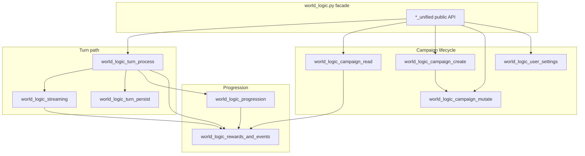

# world_logic.py modularization plan

**Status:** Revised (roadmap home — implementation PRs land in [jleechanorg/worldarchitect.ai](https://github.com/jleechanorg/worldarchitect.ai))  
**Supersedes:** design-only draft [worldarchitect.ai PR #10433](https://github.com/jleechanorg/worldarchitect.ai/pull/10433) (14-module layout); close or retarget that PR to link here after merge.  
**Measured baseline:** `wc -l mvp_site/world_logic.py` → **12,966** lines (2026-10-12, `origin/main`)  
**Related beads / prior art:** design-retro Finding 01 (`docs/plans/design-retro-2026-06/01-core-module-god-function-accretion-blocks-testability-and-co.md`), bead rev-0yt8m (long-term ≤4000 target), Gate 6 in `.github/workflows/design-doc-gate.yml`  
**CI context:** Gate 6 ratchet raised to **14,000** in PR #10428 to unblock merges while this plan executes.

**Roadmap revision note:** Re-validation used the same `origin/main` baseline as the #10433 draft (symbol sizes, cluster boundaries, MCP map). Executors should re-run `wc -l`, `grep -E '^def |^async def |^class ' mvp_site/world_logic.py`, and import-graph spot checks on the branch they extract from before each move-only PR.

---

## 1. Problem statement

`mvp_site/world_logic.py` is the unified MCP/Flask business-logic surface: campaign CRUD, turn processing, streaming finalization, level-up modal enforcement, rewards-box synthesis, page-load reconciliation, god-mode directives, and Firestore persistence. It has grown into a single file with:

- **171** top-level functions/classes (**34** public `*_unified` or API helpers, **137** private helpers).
- One **2,294-line** async entrypoint: `process_action_unified` (lines 8927–11220).
- Other multi-hundred-line hotspots: `_enforce_character_creation_modal_lock` (726), `create_campaign_unified` (721), `inject_modal_finish_choice_if_needed` (396), `get_campaign_state_unified` (221).
- **276+** repo files reference `world_logic`; unit tests alone contain **~447** `@patch("mvp_site.world_logic…")` sites (heavily concentrated in `mvp_site/tests/test_world_logic.py`).

The file already uses a **facade re-export** for `create_quick_start_campaign_unified` (implemented in `mvp_site/quick_start_campaign.py`, imported in `world_logic.py` for MCP compatibility). That pattern should remain the default for all extractions through the facade-tightening PR.

---

## 2. Current responsibilities (clusters)

Clusters overlap (helpers call across concerns). The table maps **primary ownership** by line region and largest symbols.

| Cluster | Approx. line region | Key symbols | Primary dependencies |
|--------|---------------------|-------------|----------------------|
| **Module bootstrap** | 1–220 | Firebase init, lazy `firestore_service` / `llm_service`, constants | `lazy_module_loader`, `service_account_loader` |
| **Rewards / XP / story projection** | 221–2270 | `normalize_rewards_box_for_ui`, `_enforce_primary_rewards_box_postcondition`, `_synthesize_*`, `append_canonical_level_up_story_projection` | `rewards_engine`, `game_state`, `structured_fields_utils` |
| **Level-up invariants & sealing** | 2271–3179 | `_enforce_level_up_non_finish_commit_invariant`, `_seal_level_up_on_finish_click`, freeze-time helpers | `level_up_session`, `rewards_engine` |
| **Character-creation / level-up modal lock** | 3180–4738 | `_enforce_character_creation_modal_lock`, choice expansion, freeze-time filtering | `rewards_engine`, `agents` |
| **Modal finish / choice injection** | 4739–5235 | `inject_modal_finish_choice_if_needed`, stale choice repair | `level_up_session`, planning-block helpers |
| **Streaming finalize & validation** | 5236–6094 | `finalize_streaming_state_before_persistence`, `validate_game_state_updates`, `_prepare_game_state` | `llm_parser`, `firestore_service`, `stream_events` |
| **Turn load / persist / living world** | 6095–7383 | `_load_campaign_and_continue_story`, `_persist_turn_to_firestore`, `inject_persisted_living_world_fallback` | `llm_service`, `living_world_contract` |
| **Campaign create** | 7384–8926 | `create_campaign_unified`, prompt build, debug/spicy handlers | `firestore_service`, templates |
| **Turn processing (god function)** | 8927–11580 | `process_action_unified`, god-mode directive merge, faction headers | Almost all of the above + `agents`, `intent_classifier` |
| **Campaign read / page load** | 11581–12082 | `get_campaign_state_unified`, `_fetch_campaign_state_for_page_load`, `_finalize_page_load_story_view` | `firestore_service`, pagination helpers |
| **Campaign mutate / export / list** | 11804–12115 | `update_campaign_unified`, `export_campaign_unified`, `get_campaigns_list_unified` | `firestore_service`, `_share_token` |
| **User settings API** | 12116–12393 | `get_user_settings_unified`, `update_user_settings_unified`, API key reveal | Firestore user docs |
| **Terminal sync / combat cleanup / SET** | 12394–12966 | `apply_social_hp_challenge_terminal_sync`, `apply_automatic_combat_cleanup`, `_handle_set_command` | `game_state`, NPC terminal helpers |

### 2.1 External call graph (stable contracts)

These callers must keep working without import-path churn in early PRs:

| Caller | Usage |
|--------|--------|
| `mvp_site/mcp_api.py` | Awaits `world_logic.*_unified` for every MCP tool |
| `mvp_site/mcp_client.py` | `getattr(world_logic, function_name)` tool map (10 tools) |
| `mvp_site/main.py` | Direct awaits for settings routes; occasional private helpers (`_strip_*`) |
| `mvp_site/worldai_mcp_stdio.py` | MCP server binding to `world_logic` module |
| Tests / `testing_mcp` | Patch `mvp_site.world_logic.<symbol>` extensively |

**MCP tool → function map** (from `mcp_client.py`):  
`create_campaign`, `quick_start_campaign`, `get_campaign_state`, `process_action`, `update_campaign`, `export_campaign`, `get_campaigns_list`, `get_user_settings`, `update_user_settings` → corresponding `*_unified` on `world_logic`.

---

## 3. Why this split (vs the 14-module draft)

The [#10433 draft](https://github.com/jleechanorg/worldarchitect.ai/pull/10433) proposed **14** sibling modules plus a facade. This revision recommends **10** extracted siblings plus the facade (**11** code files under `mvp_site/` including `world_logic.py`).

| Draft module | Issue | Recommendation |
|--------------|-------|----------------|
| `world_logic_world_events.py` (~700) | Living-world and scene normalization overlap rewards-box synthesis **and** `inject_persisted_living_world_fallback` (~265 LOC) in the persist cluster; three modules would ping-pong the same envelopes. | **Merge into** `world_logic_rewards_and_events.py` with the rewards cluster (lines 221–2270 plus world-event helpers that today sit adjacent to rewards / story projection). Keep **persist-time** living-world fallback in turn persist. |
| `world_logic_modal_choices.py` (~900) | Modal finish injection, stale choice repair, and CC/level-up modal lock share freeze-time state and `level_up_session`; splitting produced mutual private imports in the draft graph. | **Merge into** `world_logic_progression.py` with level-up invariants and modal lock (~3,100 LOC). |
| `world_logic_god_mode.py` (~450) | God-mode directive merge is only invoked from the turn pipeline (`process_action_unified` region); a separate module adds a thin layer with high coupling to turn stages and no MCP surface. | **Keep inside** `world_logic_turn_process.py` as named stage helpers until the orchestrator is ≤400 LOC (same PR series as P7). |
| `world_logic_campaign_write.py` (~350) + `world_logic_state_commands.py` (~450) | Both are non-turn Firestore/state mutation paths (update/export/list vs SET/combat/social HP). Each alone is below a comfortable ownership threshold. | **Merge into** `world_logic_campaign_mutate.py` (~800 LOC). |
| `world_logic_user_settings.py` (~350) | Thin but **distinct** MCP tools and `main.py` routes on user docs, not campaign docs. | **Keep separate** for stable mental model and test clustering. |

**Layout choice:** Use **facade + sibling modules** under `mvp_site/` (same as `quick_start_campaign.py`) through the patch-path cleanup PR. Do **not** rename to a `world_logic/` package in early PRs — that forces hundreds of test patch updates at once. An optional later PR may introduce `mvp_site/world_logic/` with `__init__.py` re-exports once siblings stabilize.

**Dependency rule (avoid cycles):** leaf helpers must not import `world_logic` or `world_logic_turn_process`. Allowed direction: `turn_process → {streaming, persist, progression, rewards_and_events} → {game_state, rewards_engine, firestore_service}`.

---

## 4. Target module layout (recommended)

Keep **`mvp_site/world_logic.py` as the public facade** until the final tightening PR.

| Module | Target LOC | Moved concerns |
|--------|------------|----------------|
| `world_logic_bootstrap.py` | ~250 | Firebase init, lazy imports, shared constants, Dragon Knight template blobs |
| `world_logic_rewards_and_events.py` | ~2,100 | Rewards-box builders, synthesis, postconditions, UI normalization, world-event / scene annotation helpers (draft `world_events` + rewards cluster) |
| `world_logic_progression.py` | ~3,100 | Level-up invariants, sealing, modal lock, finish-choice injection, stale-offer scrub, story projection hooks (draft `level_up` + `modal_choices`) |
| `world_logic_streaming.py` | ~650 | `finalize_streaming_state_before_persistence`, spicy-mode injection, pre-persist validation |
| `world_logic_turn_persist.py` | ~1,050 | `_prepare_game_state*`, `_load_campaign_and_continue_story`, `_persist_turn_to_firestore`, `inject_persisted_living_world_fallback` |
| `world_logic_campaign_create.py` | ~850 | `create_campaign_unified` and private prompt/debug/spicy helpers |
| `world_logic_turn_process.py` | ~2,850 | `process_action_unified` orchestrator + stage functions + god-mode directive stages (same file until orchestrator ≤400 LOC) |
| `world_logic_campaign_read.py` | ~650 | `get_campaign_state_unified`, page-load fetch/finalize, pagination metadata |
| `world_logic_campaign_mutate.py` | ~800 | `update_campaign_unified`, `export_campaign_unified`, list helpers, SET/UPDATE handlers, social HP terminal sync, combat cleanup |
| `world_logic_user_settings.py` | ~350 | Settings unified APIs, error/success response helpers |
| **`world_logic.py` (facade)** | **≤800** | Re-exports only: unified entrypoints + symbols tests patch today |

**End state:** facade under **800 LOC**; largest sibling **`world_logic_progression.py` ~3,100** and **`world_logic_turn_process.py` ~2,850** (both under the ≤4,000 interim bead target); `process_action_unified` ≤ **400** lines delegating to named stages (load → agent → finalize → persist).

---

## 5. Incremental PR sequence (behavior-preserving)

Each PR should be **move-only** (no semantic edits), with:

1. New module containing moved functions (copy-paste + adjust imports).
2. `world_logic.py` replaces bodies with imports and **re-exports** (`from mvp_site.world_logic_rewards_and_events import foo as foo` or thin wrappers).
3. Scoped tests green: `./run_tests.sh mvp_site/tests/test_world_logic.py -k '<cluster>'` plus any cluster-specific files touched historically.
4. Optional **`test_world_logic_facade_exports.py`**: assert `dir(world_logic)` / `getattr` parity for the MCP tool map and top 50 patched symbols.
5. Gate 6 ratchet: **do not lower** bound until facade LOC drops; optionally add per-module upper bounds in a follow-up workflow change after PR 3.

| PR | Scope | Est. LOC moved | Proof focus |
|----|--------|----------------|-------------|
| **P0** | This plan in **worldarchitect-roadmap** (no code moves) | 0 | N/A |
| **P1** | Extract `world_logic_bootstrap.py` | ~250 | Import smoke + lazy loader tests |
| **P2** | Extract `world_logic_rewards_and_events.py` (rewards + world-event helpers) | ~2,100 | `test_rewards_*`, canonicalize invariants, design-doc Gate 1/3 |
| **P3** | Extract `world_logic_campaign_read.py` (page load) | ~650 | Pagination / page-load tests |
| **P4** | Extract `world_logic_progression.py` (level-up + modal) | ~3,100 | Level-up modal, freeze-time, CC lock tests |
| **P5** | Extract `world_logic_streaming.py` + `world_logic_turn_persist.py` | ~1,700 | Streaming orchestrator, finalize_streaming, persist tests |
| **P6** | Move `create_campaign_unified` → `world_logic_campaign_create.py` | ~850 | Campaign creation / quick-start integration |
| **P7** | Move `process_action_unified` + god-mode stages → `world_logic_turn_process.py`; leave thin orchestrator re-export in facade | ~2,850 | Broad `test_world_logic.py` + MCP smoke |
| **P8** | Extract `world_logic_campaign_mutate.py` | ~800 | MCP update/export/list + SET/combat tests |
| **P9** | Extract `world_logic_user_settings.py` | ~350 | Settings routes + MCP tool map |
| **P10** | Delete re-export shims where safe; bulk-update `@patch` paths; tighten Gate 6 toward 4k facade goal | varies | Full scoped world_logic suite + MCP e2e |

**Ordering rationale:** start with **low fan-in** helpers (bootstrap, rewards/events) to prove the re-export pattern; land **progression** before streaming/persist so finalize paths call stable modules; defer **`process_action_unified`** until dependencies live in siblings; keep **user settings** near the end because it is loosely coupled. Design-doc gates that grep **`mvp_site/world_logic.py`** literally (Gates 1, 1b, 3) stay on the facade file until gate definitions move in a dedicated CI PR.

---

## 6. Testing strategy per extraction

| Layer | What to run | Pass criteria |
|-------|-------------|---------------|
| **Unit (mocked)** | Cluster filters on `mvp_site/tests/test_world_logic.py`, rewards/level-up focused files | Same pass count as pre-PR; no assertion changes |
| **Facade contract** | New/extended test: MCP `tool_mapping` names resolve on `world_logic` | All tools `getattr`-able |
| **Import hygiene** | `python3 -c "import mvp_site.world_logic"` from repo root | No circular import |
| **Design doc gates** | Workflow on PR touching `mvp_site/**/*.py` | Gates 1–7 still pass (grep targets may still be facade) |
| **Integration** | `./run_tests.sh mvp_site/tests/test_end2end/test_continue_story_end2end.py` when turn path touched | GREEN |
| **Real path (optional, post-P7)** | Scoped `testing_mcp` smoke per `testing_mcp/CLAUDE.md` | Streaming + one turn |

**RED before move (recommended for P7):** add a characterization test that records stage order / key side-effect call sequence for `process_action_unified` with mocks fixed — fails if orchestration order changes.

---

## 7. Risks and mitigations

| Risk | Impact | Mitigation |
|------|--------|------------|
| **Import cycles** | Startup failure, flaky tests | Enforce acyclic graph (§3–4); extract leaves first; use lazy imports for `firestore_service` / `llm_service` only at bootstrap |
| **`@patch("mvp_site.world_logic…")` breakage** | Mass test failure | Keep re-exports at old names through P9; optional codemod in P10; prioritize symbols with >5 patch sites (`_persist_turn_to_firestore`, `_load_campaign_and_continue_story`, `_prepare_game_state`) |
| **`main.py` private helper imports** | Runtime ImportError | Re-export `_strip_*` from facade or move strips to `story_utils` and update main in same PR |
| **Design-doc grep gates** | CI false positives/negatives | Gates target `world_logic.py` path explicitly — document which gates must move with code vs stay on facade; schedule gate path update after P4 |
| **MCP `getattr` tool map** | 501 Tool not implemented | Never rename public `*_unified` without facade alias; contract test in P1 |
| **Prompt / cache hashes** | False cache-regression alarms | **Do not move prompt assembly** in early PRs; moves are refactors of enforcement/persistence only; if prompt bytes move files, run prefix-cache measurement per `.claude/skills/prompt-prefix-caching.md` |
| **LazyLoader semantics** | Eager import regressions | New modules must not `from mvp_site.firestore_service import X`; use `lazy_module` at bootstrap only |
| **LOC ratchet gaming** | Empty facade + bloated siblings | After P10, add optional per-module bounds or sum-of-modules check tied to rev-0yt8m |
| **Merge conflicts** | Hotspot churn | Land P1–P3 quickly; schedule P7 in a quiet window; prefer move-only commits |

---

## 8. Success metrics

| Metric | Today | After P10 (target) |
|--------|-------|---------------------|
| `world_logic.py` LOC | 12,966 | ≤800 (facade) |
| `process_action_unified` LOC | 2,294 | ≤400 orchestrator |
| Largest module LOC | 12,966 | ≤3,100 (`progression`) |
| Test patch churn per extraction PR | — | 0 failing tests; ≤10 patch path updates until P10 |

---

## 9. Out of scope (separate tracks)

- **`llm_service.py` god-function split** — parallel effort (design-retro Finding 01); do not combine with world_logic P7 in one PR.
- **Semantic refactors** (ZFC routing, new adjusters, prompt changes) — forbidden inside move-only PRs.
- **Lowering Gate 6 below actual LOC** — only after corresponding extraction merges.
- **`mvp_site/world_logic/` package rename** — optional follow-up after P10 once `@patch` paths are updated.

---

## 10. Appendix: largest symbols (extraction priority)

| Lines | LOC | Symbol |
|------:|----:|--------|
| 8927 | 2294 | `process_action_unified` |
| 3180 | 726 | `_enforce_character_creation_modal_lock` |
| 7384 | 721 | `create_campaign_unified` |
| 4739 | 396 | `inject_modal_finish_choice_if_needed` |
| 6904 | 265 | `inject_persisted_living_world_fallback` |
| 6249 | 242 | `_load_campaign_and_continue_story` |
| 11581 | 221 | `get_campaign_state_unified` |
| 2392 | 210 | `_enforce_level_up_non_finish_commit_invariant` |
| 5343 | 198 | `finalize_streaming_state_before_persistence` |

---

## 11. References

- [worldarchitect-roadmap — this document](https://github.com/jleechanorg/worldarchitect-roadmap/blob/main/2026-10-12-0135-world-logic-modularization-plan.md) (canonical plan home after merge)
- `.github/workflows/design-doc-gate.yml` — Gate 6 LOC ratchet (14,000 after #10428)
- `mvp_site/quick_start_campaign.py` — precedent for MCP-visible extraction + facade re-export
- `docs/plans/design-retro-2026-06/01-core-module-god-function-accretion-blocks-testability-and-co.md` — original finding
- `mvp_site/lazy_module_loader.py` — shared lazy import mechanism
